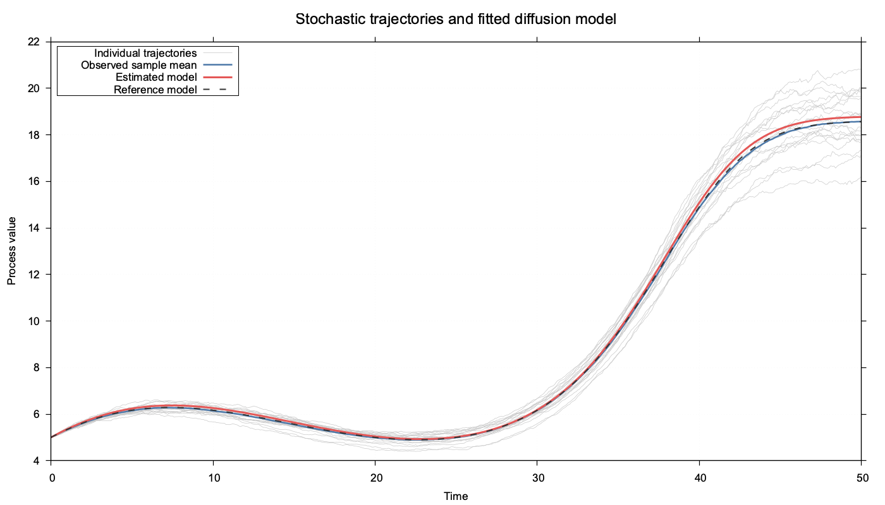
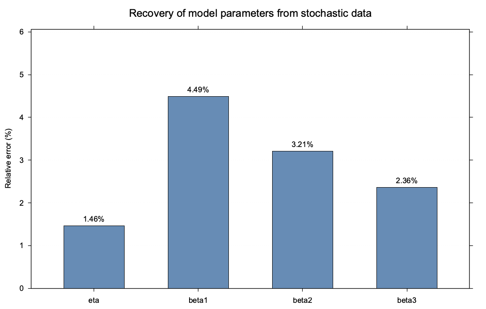
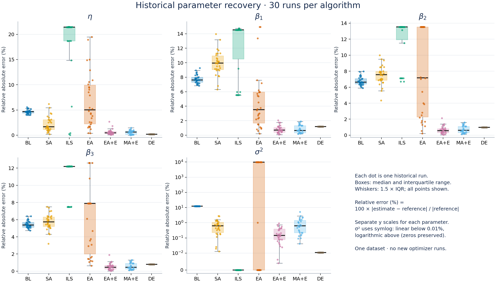
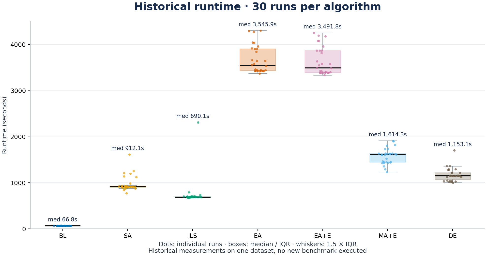

# StochasticDiffusion

C++ parameter estimation and optimization for a stochastic multi-sigmoidal diffusion model.

[](https://github.com/samugc/StochasticDiffusion/actions/workflows/ci.yml)

Developed from my Bachelor's thesis in Mathematics and Computer Engineering at the University of Granada.

## Overview

This project estimates the parameters of a stochastic diffusion process whose mean follows a multi-sigmoidal growth curve. Starting from simulated trajectories, it combines mathematical initialization, likelihood-based numerical and evolutionary optimization, and experimental comparison. The repository includes a fast regression-based demo and a separately documented historical optimization study.

## Quick demo



The supplied dataset contains **100 stochastic trajectories observed at 501 time points**. Regression-based initialization estimates four shape parameters: η, β₁, β₂ and β₃. In this demo, their maximum relative absolute error is **4.49%**.

| Parameter | Estimate | Reference | Relative absolute error |
|---|---:|---:|---:|
| η | 0.362512 | 0.367879 | 1.46% |
| β₁ | 0.104492 | 0.100000 | 4.49% |
| β₂ | -0.009289 | -0.009000 | 3.21% |
| β₃ | 0.000205 | 0.000200 | 2.36% |

Displayed estimates are rounded; relative errors use the underlying estimates. The estimated-model RMSE against the sample mean is **0.137678**. The generating reference model has RMSE **0.031751** against that same finite-sample mean.



**This quick demo is not the seven-algorithm historical benchmark.** It does not run Newton–Raphson or the stochastic optimizers.

## Historical optimization study

The original thesis records **30 historical runs for each of seven optimization methods**: 210 documented optimization runs, each with five parameter estimates, fitness and runtime. These rows were reconstructed from the original individual-run tables. All **1,050 absolute parameter errors were independently recalculated and validated against the historical CSV records**; this checks transcription consistency, not independent replication of the experiments.

The methods are Local Search (BL), Simulated Annealing (SA), Iterated Local Search (ILS), Evolutionary Algorithm (EA), Evolutionary Algorithm with elitism (EA+E), Memetic Algorithm with elitism (MA+E), and Differential Evolution (DE).

**The optimizers were not rerun in 2026.** Historical seeds and complete raw execution logs are unavailable. All results concern one simulated dataset. The fifth parameter, σ², is diffusion variance; fitness is an objective value, not parameter error or RAE.



| Method | Median runtime | Historical observation |
|---|---:|---|
| BL | 66.8 s | Lowest median runtime; nonzero errors across all five parameters. |
| SA | 912.1 s | Lower mean η and σ² errors than BL, with higher median runtime. |
| ILS | 690.1 s | Largest mean η error; reported σ² matches the reference in every run. |
| EA | 3545.9 s | Large σ² errors and substantial parameter variability. |
| EA+E | 3491.8 s | Lower mean error than EA for each parameter in this dataset. |
| MA+E | 1614.4 s | Lower median runtime than EA+E; parameter-wise errors differ. |
| DE | 1153.1 s | Lowest mean η error; estimates vary little at the recorded precision. |

These observations describe this experiment, not a universal ranking of optimizers.



See the [complete historical analysis and per-parameter runtime–error trade-off](results/README.md) for metric definitions, provenance, validation and reproduction commands.

## Estimation pipeline

```text
trajectories → sample statistics → model-specific transformation
            → polynomial regression → initial parameters
            → likelihood-based optimization → statistical analysis
```

The initialization transforms the sample means and fits a cubic polynomial using a Vandermonde design matrix. Its intercept gives η through exponentiation; the remaining coefficients give β₁, β₂ and β₃. The quick demo stops at this initialization and evaluates the resulting mean curve.

The current implementation replaces transformation values detected as `NaN` with zero; it does not apply a general finite-value filter. The demo should therefore be interpreted according to this existing implementation, including its indexing and endpoint handling, rather than as an idealized transformation valid at every observation.

## Methods implemented

- Newton–Raphson with Ceres AutoDiff for derivatives.
- Local Search.
- Simulated Annealing.
- Iterated Local Search (ILS).
- Evolutionary Algorithm.
- Evolutionary Algorithm with elitism.
- Memetic Algorithm with elitism.
- Differential Evolution.

These implementations are present in the research code; the default executable runs only the quick demo.

## Statistical analysis

The regenerated analysis applies **Kruskal–Wallis to relative absolute parameter error**, separately for each of the five parameters. All five omnibus tests remain significant after **Holm correction across the five p-values**. These tests identify distribution/rank differences, not a globally superior method or specific pairwise differences.

The new analysis makes **no paired Wilcoxon conclusion**, because pairing between runs of different algorithms is not documented. Independence assumptions, rounding and the single-dataset scope remain limitations. See the [statistical report](results/statistical_tests.md) for H statistics, raw and adjusted p-values, and interpretation.

## Reproducibility

**Current demo:** reproducible now from the supplied source and data. Requires a C++17 compiler, CMake ≥ 3.16, Eigen3, Ceres Solver and Boost. On Ubuntu:

```bash
sudo apt-get update
sudo apt-get install -y cmake g++ libeigen3-dev libceres-dev libboost-dev
```

Run from the repository root:

```bash
cmake -S . -B build -DCMAKE_BUILD_TYPE=Release
cmake --build build --parallel 2
./build/stochastic_diffusion
ctest --test-dir build --output-on-failure
```

Optional plotting requires `gnuplot` (for example, `sudo apt-get install gnuplot-nox` on Ubuntu). It regenerates the three quick-demo figures:

```bash
./build/stochastic_diffusion --plot
```

**Historical benchmark:** reconstructed from original thesis records, with source hashes, row-level provenance and tests. Its summaries and figures can be regenerated, but an exact optimizer rerun is not fully reproducible because seeds and complete raw logs are missing.

With Python 3.13, preferably in a virtual environment:

```bash
python -m pip install -r python/requirements-historical.txt
python -B python/analyze_historical_results.py
python -B -m unittest discover -s python -p 'test_historical_results.py' -v
```

The analysis reads only `results/historical_runs.csv` and regenerates its summaries, statistical report and historical figures. It does not execute optimization algorithms. CI builds Release, runs the CTest smoke test, regenerates the historical analysis and runs its validation tests; CI does not use `--plot` or require gnuplot.

## Project structure

```text
src/       C++ model, estimation, optimization and demo
include/   C++ interfaces
data/      Supplied simulated trajectories
figures/   Quick-demo and historical-analysis figures
results/   Historical runs, summaries, provenance and statistical report
python/    Historical extraction, analysis and validation scripts
```

## Research origin

Bachelor's thesis, University of Granada, 2025:

*Estudio y aplicación de algoritmos de optimización evolutivos para la obtención de estimaciones en procesos de difusión*.

Related conference abstract, as co-author: *Evolutionary Optimisation Algorithms for the Estimation of Diffusion Processes*, **DSABNS 2026**. The available evidence is a conference abstract/program entry, not a full peer-reviewed paper; no presenter role is claimed here.

## Limitations

- One simulated dataset; optimizer comparisons are experiment-specific.
- Historical seeds and complete raw logs are unavailable.
- Historical aggregate tables contained inconsistencies, so public summaries are regenerated from individual rows.
- Research software, not a general-purpose optimization library.
